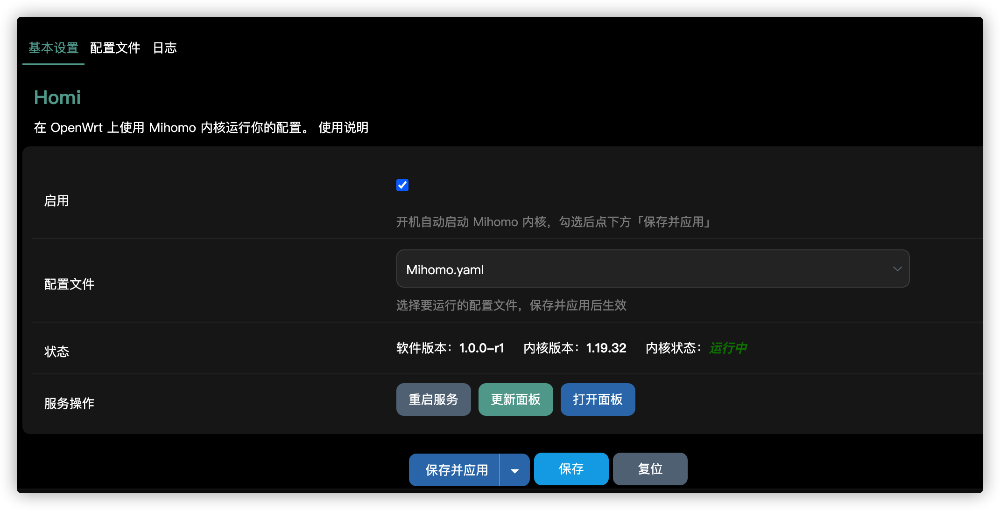
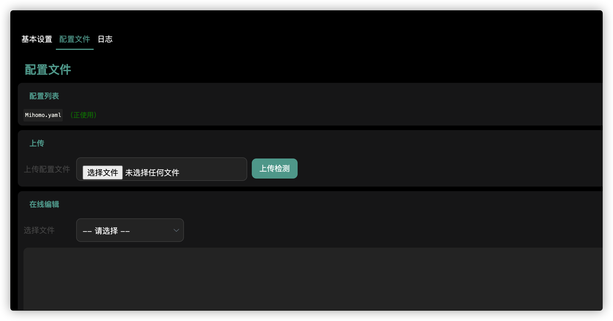
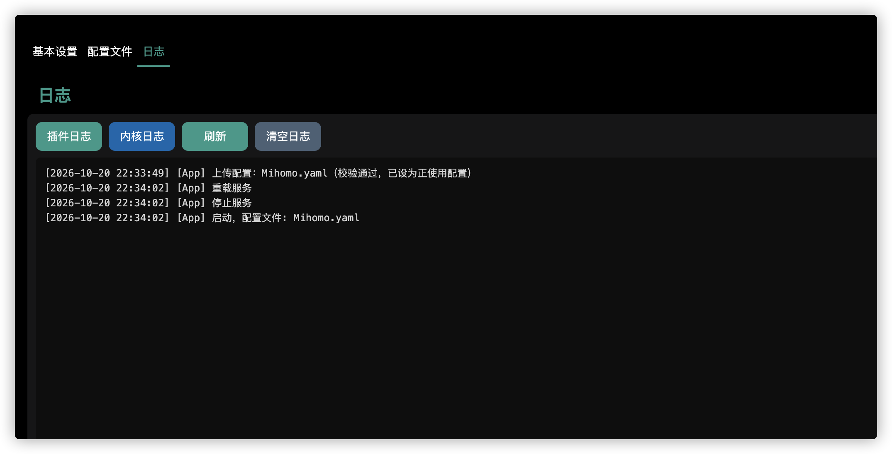

# Homi

极简的 Mihomo LuCI 应用：上传你的配置文件，立刻以透明代理跑起来。没有订阅管理，没有多余功能，只有核心——上传、校验、启动，快。

## 功能

- **基本设置**：软件版本、内核版本、运行状态一目了然；选择要运行的配置文件；启用开关（开机自启）；重启服务；更新面板；打开面板（按配置中的 `external-controller` 自动拼地址）
- **配置文件**：上传后自动校验（过 `mihomo -t` 才算数，通过后自动设为正使用）；配置列表管理；在线编辑（保存 / 保存并应用）
- **日志**：插件日志与内核日志分开看，5 秒自动刷新，只保留最后 500 行
- **卸载干净**：卸载服务包时自动清掉配置、缓存、面板和日志，不留残余

透明代理由配置文件决定：在配置里开启 `tun`，局域网流量即经 Mihomo 转发。

## 界面预览

基本设置：版本、状态、选择配置、启用与服务操作



配置文件：配置列表、上传校验、在线编辑



日志：插件日志与内核日志



## 一键安装

```sh
curl -fsSL https://raw.githubusercontent.com/pg-go/Homi/main/install.sh | sh
```

脚本会自动识别 CPU 架构（x86_64 / aarch64 / armv7）和包管理器（opkg 装 ipk，apk 装 apk），从 GitHub Release 下载对应安装包并安装。

安装完成后，打开 LuCI → 服务 → Homi：

1. 在「配置文件」页上传你的 yaml（自动校验，通过后设为正使用）
2. 回「基本设置」页确认配置文件选对，勾选「启用」，保存并应用
3. 内核随即启动，透明代理生效

## 配置文件说明

配置文件都放在 `/etc/homi/`，可以存多份，在基本设置页切换要运行哪一份。

想用「打开面板」按钮，配置里需要打开 API：

```yaml
external-controller: 0.0.0.0:9090
secret: "你的面板密码，可留空"
external-ui: ui   # 面板目录，点「更新面板」会自动下载到这里
```

仓库里有一份带注释的示例：`homi/files/etc/homi/config.yaml.example`

## 安装了什么

| 包名 | 内容 |
|---|---|
| `mihomo` | Mihomo 内核二进制（/usr/bin/mihomo），CI 从 MetaCubeX/mihomo 源码编译 |
| `homi` | procd 服务脚本、UCI 配置、面板更新脚本 |
| `luci-app-homi` | LuCI 界面 |

## 自己编译

Release 页的安装包由 GitHub Actions 自动构建：

- 内核在 SDK 里用 OpenWrt 的 Go 打包体系（`golang-package.mk`）直接编译，不再预编译二进制
- `build-packages` 任务矩阵：5 架构 × 2 分支（`openwrt-24.10` 原生出 ipk，`openwrt-25.12` 原生出 apk），不做格式转换
- 发版：推送 `v*` 标签或手动触发（填发版标签）后自动构建并发布到 GitHub Release，在 Release 页面直接下载

Release 页面提供 10 个下载包（5 架构 × apk/ipk），命名为 `homi-<架构>-<格式>.tar.gz`，
每个包里是该架构该格式的 3 个安装包（mihomo 内核 / homi 服务 / luci-app-homi 界面）。
一键安装脚本会自动按你的系统选择下载；想单独升级某个包时，下载对应包手动安装即可。

手动触发一次构建：在仓库 Actions 页点 `build` → Run workflow。

想换内核版本：改 `mihomo/Makefile` 里的 `PKG_SOURCE_URL` / `PKG_SOURCE_VERSION`（默认 MetaCubeX/mihomo `v1.19.32`）。

## 目录结构

```
Homi/
├── install.sh                  # 一键安装脚本
├── mihomo/                     # 内核包（SDK 里用 golang-package.mk 从源码编译）
├── homi/                 # 服务包
│   └── files/
│       ├── etc/config/homi
│       ├── etc/init.d/homi
│       ├── etc/homi/config.yaml.example
│       ├── usr/sbin/homi-update-dashboard
│       └── lib/upgrade/keep.d/homi
├── luci-app-homi/        # LuCI 界面
│   ├── htdocs/                 # JS 视图
│   └── root/usr/share/         # menu.d / rpcd acl / ucode 后端
└── .github/workflows/build.yml
```

## 许可证

MIT
